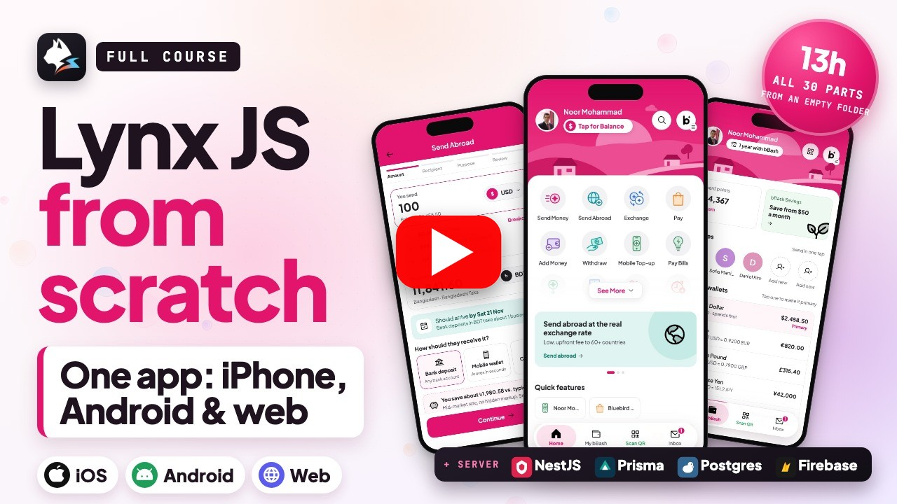

<p align="center">
  <a href="https://youtu.be/FQLa16GoUQw">
    
  </a>
</p>

<h1 align="center">bBash Lynx JS Starter Kit</h1>

<p align="center">
  <b>The fonts, icons and design data for the course <i>Lynx JS from Scratch: Build a Global Wallet for iOS, Android and the Web</i>.</b><br />
  Everything else, we type together.
</p>

<p align="center">
  <a href="https://youtu.be/FQLa16GoUQw"></a>
  <a href="https://buymeacoffee.com/reactbd/e/601029"></a>
</p>

<p align="center">
  <a href="https://www.youtube.com/@reactjsbd"></a>
  
  
  
</p>

---

> [!IMPORTANT]
> **▶ Watch the course:** [Lynx JS Full Course: Build a Real Wallet App (13 Hours)](https://youtu.be/FQLa16GoUQw). Every file typed and explained on screen, from an empty folder to iPhone, Android and the web.
>
> **💻 Want the finished project?** [Get the complete bBash Global source code](https://buymeacoffee.com/reactbd/e/601029): the Lynx app, the NestJS server, the native iPhone and Android hosts, Lynx for Web, 44 tests, and step-by-step setup guides. No keys included; every `.env` value says where to get it.

## ▶ Watch the full course

<p align="center">
  <a href="https://youtu.be/FQLa16GoUQw" title="Watch Lynx JS Full Course on YouTube">
    
  </a>
  <br />
  <a href="https://youtu.be/FQLa16GoUQw"><b>▶ Lynx JS Full Course: Build a Real Wallet App (13 Hours)</b></a>
  &nbsp;·&nbsp;
  <a href="https://buymeacoffee.com/reactbd/e/601029"><b>💻 Get the full source code</b></a>
</p>

All 30 parts are in one video. Click any time below to jump straight to that part.

<details open>
<summary><b>The 31 chapters</b> (click a time to open the video there)</summary>

| Time | Chapter |
| --- | --- |
| [`0:00:00`](https://youtu.be/FQLa16GoUQw?t=0) | [Trailer: what we build](https://youtu.be/FQLa16GoUQw?t=0) |
| [`0:07:35`](https://youtu.be/FQLa16GoUQw?t=455) | [Part 1 · What Lynx is](https://youtu.be/FQLa16GoUQw?t=455) |
| [`0:15:11`](https://youtu.be/FQLa16GoUQw?t=911) | [Part 2 · Lynx compared](https://youtu.be/FQLa16GoUQw?t=911) |
| [`0:20:34`](https://youtu.be/FQLa16GoUQw?t=1234) | [Part 3 · Your workstation](https://youtu.be/FQLa16GoUQw?t=1234) |
| [`0:27:00`](https://youtu.be/FQLa16GoUQw?t=1620) | [Part 4 · An empty folder](https://youtu.be/FQLa16GoUQw?t=1620) |
| [`0:42:55`](https://youtu.be/FQLa16GoUQw?t=2575) | [Part 5 · Elements, events and Lynx CSS](https://youtu.be/FQLa16GoUQw?t=2575) |
| [`1:02:33`](https://youtu.be/FQLa16GoUQw?t=3753) | [Part 6 · The design system](https://youtu.be/FQLa16GoUQw?t=3753) |
| [`1:28:33`](https://youtu.be/FQLa16GoUQw?t=5313) | [Part 7 · The app shell](https://youtu.be/FQLa16GoUQw?t=5313) |
| [`1:45:55`](https://youtu.be/FQLa16GoUQw?t=6355) | [Part 8 · Welcome and where you live](https://youtu.be/FQLa16GoUQw?t=6355) |
| [`2:14:46`](https://youtu.be/FQLa16GoUQw?t=8086) | [Part 9 · Phone number or email](https://youtu.be/FQLa16GoUQw?t=8086) |
| [`2:39:29`](https://youtu.be/FQLa16GoUQw?t=9569) | [Part 10 · The code, your details and a PIN](https://youtu.be/FQLa16GoUQw?t=9569) |
| [`3:04:49`](https://youtu.be/FQLa16GoUQw?t=11089) | [Part 11 · Face ID and log-in](https://youtu.be/FQLa16GoUQw?t=11089) |
| [`3:28:50`](https://youtu.be/FQLa16GoUQw?t=12530) | [Part 12 · Home](https://youtu.be/FQLa16GoUQw?t=12530) |
| [`4:05:05`](https://youtu.be/FQLa16GoUQw?t=14705) | [Part 13 · The four tabs](https://youtu.be/FQLa16GoUQw?t=14705) |
| [`4:38:28`](https://youtu.be/FQLa16GoUQw?t=16708) | [Part 14 · One path for every payment](https://youtu.be/FQLa16GoUQw?t=16708) |
| [`5:21:35`](https://youtu.be/FQLa16GoUQw?t=19295) | [Part 15 · Send Abroad](https://youtu.be/FQLa16GoUQw?t=19295) |
| [`6:06:10`](https://youtu.be/FQLa16GoUQw?t=21970) | [Part 16 · Identity check, limits and split bill](https://youtu.be/FQLa16GoUQw?t=21970) |
| [`6:43:34`](https://youtu.be/FQLa16GoUQw?t=24214) | [Part 17 · Settings and the legal centre](https://youtu.be/FQLa16GoUQw?t=24214) |
| [`7:10:06`](https://youtu.be/FQLa16GoUQw?t=25806) | [Part 18 · A native iPhone app](https://youtu.be/FQLa16GoUQw?t=25806) |
| [`7:36:29`](https://youtu.be/FQLa16GoUQw?t=27389) | [Part 19 · Lynx for Web](https://youtu.be/FQLa16GoUQw?t=27389) |
| [`8:04:32`](https://youtu.be/FQLa16GoUQw?t=29072) | [Part 20 · The server](https://youtu.be/FQLa16GoUQw?t=29072) |
| [`8:31:29`](https://youtu.be/FQLa16GoUQw?t=30689) | [Part 21 · Sign-up and log-in on the server](https://youtu.be/FQLa16GoUQw?t=30689) |
| [`9:07:49`](https://youtu.be/FQLa16GoUQw?t=32869) | [Part 22 · Connecting the app](https://youtu.be/FQLa16GoUQw?t=32869) |
| [`9:34:17`](https://youtu.be/FQLa16GoUQw?t=34457) | [Part 23 · The ledger](https://youtu.be/FQLa16GoUQw?t=34457) |
| [`10:00:29`](https://youtu.be/FQLa16GoUQw?t=36029) | [Part 24 · Payments on the ledger](https://youtu.be/FQLa16GoUQw?t=36029) |
| [`10:31:41`](https://youtu.be/FQLa16GoUQw?t=37901) | [Part 25 · Staying signed in](https://youtu.be/FQLa16GoUQw?t=37901) |
| [`10:51:46`](https://youtu.be/FQLa16GoUQw?t=39106) | [Part 26 · Real text codes with Firebase](https://youtu.be/FQLa16GoUQw?t=39106) |
| [`11:18:11`](https://youtu.be/FQLa16GoUQw?t=40691) | [Part 27 · The support chat](https://youtu.be/FQLa16GoUQw?t=40691) |
| [`11:57:31`](https://youtu.be/FQLa16GoUQw?t=43051) | [Part 28 · A native Android app](https://youtu.be/FQLa16GoUQw?t=43051) |
| [`12:37:32`](https://youtu.be/FQLa16GoUQw?t=45452) | [Part 29 · Checks and tests](https://youtu.be/FQLa16GoUQw?t=45452) |
| [`12:52:40`](https://youtu.be/FQLa16GoUQw?t=46360) | [Part 30 · Going live and what's next](https://youtu.be/FQLa16GoUQw?t=46360) |

</details>

## What this is

The course builds **bBash Global**, an international wallet, from an empty folder: one React code base running as a native iPhone app, a native Android app and a website, on your own NestJS + Postgres server.

You type every screen yourself. A few files are best copied rather than typed, because they're fonts, images or long lists of data. Those files live here. When a lesson says **"copy it from the starter pack"**, the file you need is in this repo.

The folders match the app's own layout: copy a file to the same path in your project.

## What's inside, and when you need it

| Lesson | Files | Copy to |
| --- | --- | --- |
| **Part 5** · Elements, events and Lynx CSS | `PlusJakartaSans_400Regular.ttf` … `PlusJakartaSans_800ExtraBold.ttf` (5 weights) and `OFL.txt` | `src/assets/fonts/` |
| **Part 5** · Elements, events and Lynx CSS | `profile.png` (300 × 300) | `src/assets/` |
| **Part 6** · The design system | `names.txt` (197 icon names, one per line) | `src/icons/` |
| **Part 8** · Welcome and where you live | `countries.ts` (15 countries, 13 currencies) | `src/data/` |
| **Part 12** · Home | `home.ts` (services, banners, perks, offers, hero art) | `src/data/` |
| **Part 12** · Home | `illustrations.ts` (42 lines of SVG; please don't type it) | `src/icons/` |
| **Part 14** · One path for every payment | `catalog.ts` (contacts, merchants, billers, every payment flow's settings, sample transactions) and `limits.ts` | `src/data/` |
| **Part 15** · Send Abroad | `remit.ts` (corridors, payout methods, bank and wallet fields, purposes) | `src/data/` |
| **Part 17** · Settings and the legal centre | `legal.ts` (the per-country legal centre) | `src/data/` |
| **Part 19** · Lynx for Web | `favicon.ico`, `icon.svg`, `apple-touch-icon.png`, `icon-192.png`, `icon-512.png`, `icon-maskable-512.png` | `web/public/` |

The data files are the finished versions, the same ones shown on screen. Each lesson walks through how they're built, so read along even when you copy.

```text
src/
  assets/
    fonts/            Plus Jakarta Sans, 5 weights + OFL.txt
    profile.png
  icons/
    names.txt
    illustrations.ts
  data/
    countries.ts  home.ts  catalog.ts  limits.ts  remit.ts  legal.ts
web/
  public/             favicon and app icons for Lynx for Web
```

## Quick copy

From the folder that holds both your project (`bbash-lynxjs`) and this kit:

```bash
cp -R bbash-lynxjs-starter-kits/src/assets bbash-lynxjs/src/
```

Copy the rest the same way when its lesson comes up, so your project grows in the same order as the course.

## No starter pack? You can still follow along

- **Fonts:** Part 5 also installs `@expo-google-fonts/plus-jakarta-sans`. The same five `.ttf` files are inside its folder in `node_modules`.
- **Icon names:** type the names you see on screen in Part 6.
- **Web icons:** Part 19 generates all six with a small Python script.

## Licences

- **Plus Jakarta Sans** is © The Plus Jakarta Sans Project Authors, under the [SIL Open Font License 1.1](src/assets/fonts/OFL.txt). Keep `OFL.txt` next to the fonts when you ship them.
- The icon names come from [Phosphor Icons](https://phosphoricons.com) (MIT).
- The data files, illustrations and app icons are the course's own, here for you to learn with and build the course project. The photos in `home.ts` are loaded from Unsplash at run time, under the Unsplash License.

## The course

| | |
| --- | --- |
| ▶ **Full course (free)** | **[Lynx JS Full Course: Build a Real Wallet App (13 Hours)](https://youtu.be/FQLa16GoUQw)** |
| 💻 **Finished source code** | **[bBash Global: Lynx JS Wallet App for iOS, Android & Web + NestJS API](https://buymeacoffee.com/reactbd/e/601029)** |

- YouTube: [@reactjsbd](https://www.youtube.com/@reactjsbd)
- Medium: [@reactbd](https://medium.com/@reactbd)
- Website: [reactbd.com](https://reactbd.com)

Stuck on a step? Leave a comment under the video with the part number, the timestamp and the error.
