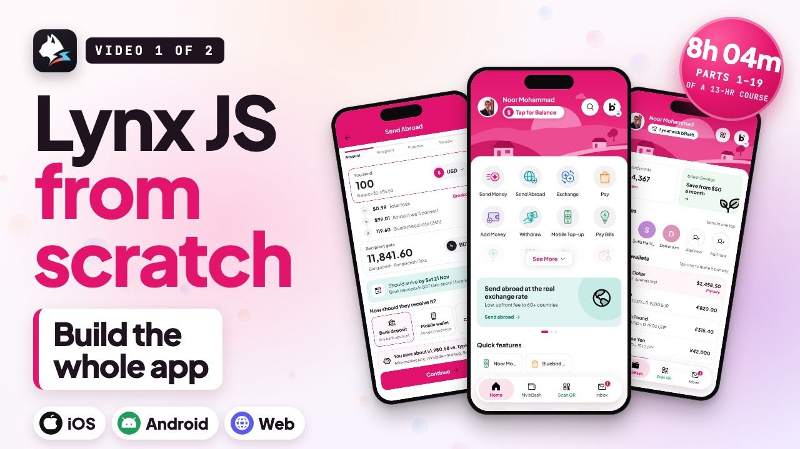

<p align="center">
  <a href="https://www.youtube.com/@reactjsbd">
    
  </a>
</p>

<h1 align="center">bBash Lynx JS Starter Kit</h1>

<p align="center">
  <b>The fonts, icons and design data for the course <i>Lynx JS from Scratch: Build a Global Wallet for iOS, Android and the Web</i>.</b><br />
  Everything else, we type together.
</p>

<p align="center">
  <a href="https://www.youtube.com/@reactjsbd"></a>
  
  
  
</p>

---

## What this is

The course builds **bBash Global**, an international wallet, from an empty folder: one React code base running as a native iPhone app, a native Android app and a website, on your own NestJS + Postgres server.

You type every screen yourself. A few files are best copied rather than typed, because they're fonts, images or long lists of data. Those files live here. When a lesson says **"copy it from the starter pack"**, the file you need is in this repo.

The folders match the app's own layout: copy a file to the same path in your project.

## What's inside, and when you need it

| Lesson | Files | Copy to |
| --- | --- | --- |
| **Part 5** · Elements, events and Lynx CSS | `PlusJakartaSans_400Regular.ttf` … `PlusJakartaSans_800ExtraBold.ttf` (5 weights) and `OFL.txt` | `src/assets/fonts/` |
| **Part 5** · Elements, events and Lynx CSS | `profile.png` (300 × 300) | `src/assets/` |
| **Part 6** · The design system | `names.txt` (197 icon names, one per line) | `src/icons/` |
| **Part 8** · Welcome and where you live | `countries.ts` (15 countries, 13 currencies) | `src/data/` |
| **Part 12** · Home | `home.ts` (services, banners, perks, offers, hero art) | `src/data/` |
| **Part 12** · Home | `illustrations.ts` (42 lines of SVG; please don't type it) | `src/icons/` |
| **Part 14** · One path for every payment | `catalog.ts` (contacts, merchants, billers, every payment flow's settings, sample transactions) and `limits.ts` | `src/data/` |
| **Part 15** · Send Abroad | `remit.ts` (corridors, payout methods, bank and wallet fields, purposes) | `src/data/` |
| **Part 17** · Settings and the legal centre | `legal.ts` (the per-country legal centre) | `src/data/` |
| **Part 19** · Lynx for Web | `favicon.ico`, `icon.svg`, `apple-touch-icon.png`, `icon-192.png`, `icon-512.png`, `icon-maskable-512.png` | `web/public/` |

The data files are the finished versions, the same ones shown on screen. Each lesson walks through how they're built, so read along even when you copy.

```text
src/
  assets/
    fonts/            Plus Jakarta Sans, 5 weights + OFL.txt
    profile.png
  icons/
    names.txt
    illustrations.ts
  data/
    countries.ts  home.ts  catalog.ts  limits.ts  remit.ts  legal.ts
web/
  public/             favicon and app icons for Lynx for Web
```

## Quick copy

From the folder that holds both your project (`bbash-lynxjs`) and this kit:

```bash
cp -R bbash-lynxjs-starter-kits/src/assets bbash-lynxjs/src/
```

Copy the rest the same way when its lesson comes up, so your project grows in the same order as the course.

## No starter pack? You can still follow along

- **Fonts:** Part 5 also installs `@expo-google-fonts/plus-jakarta-sans`. The same five `.ttf` files are inside its folder in `node_modules`.
- **Icon names:** type the names you see on screen in Part 6.
- **Web icons:** Part 19 generates all six with a small Python script.

## Licences

- **Plus Jakarta Sans** is © The Plus Jakarta Sans Project Authors, under the [SIL Open Font License 1.1](src/assets/fonts/OFL.txt). Keep `OFL.txt` next to the fonts when you ship them.
- The icon names come from [Phosphor Icons](https://phosphoricons.com) (MIT).
- The data files, illustrations and app icons are the course's own, here for you to learn with and build the course project. The photos in `home.ts` are loaded from Unsplash at run time, under the Unsplash License.

## The course

- YouTube: [@reactjsbd](https://www.youtube.com/@reactjsbd)
- Medium: [@reactbd](https://medium.com/@reactbd)
- Website: [reactbd.com](https://reactbd.com)

Stuck on a step? Leave a comment under the video with the part number, the timestamp and the error.
